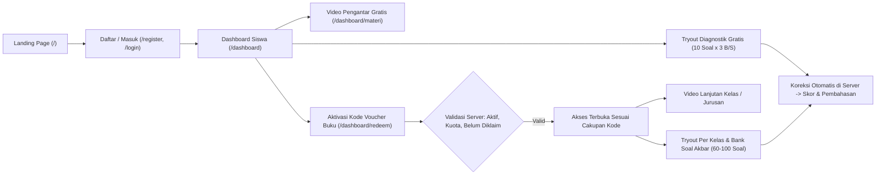
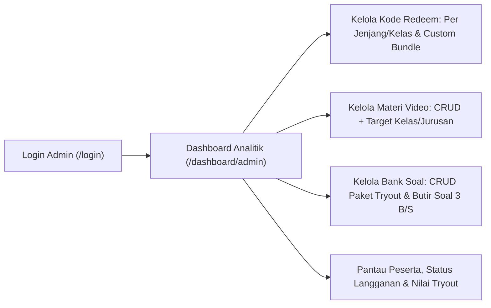
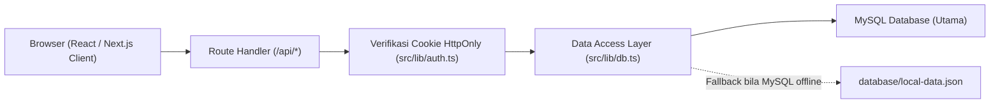
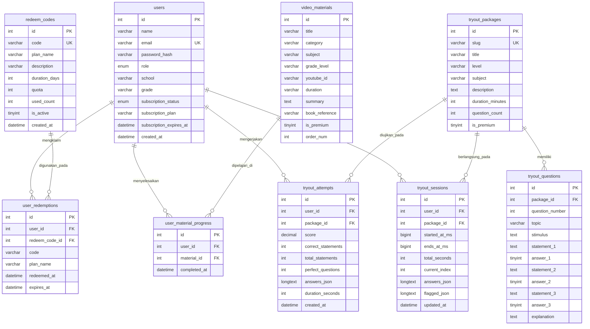

# Portal Tryout Online & Video Pembelajaran Liniswara

Platform web full-stack pendamping buku pelajaran terbitan **PT Lini Suara Nusantara (Liniswara)** untuk seluruh jenjang pendidikan (**SD/MI**, **SMP/MTs**, **SMA/MA**, dan **SMK/MAK**) termasuk seri **SMART STEPS: TKA (Tes Kemampuan Akademik)**. Dibangun menggunakan **Next.js 14 (App Router)**, **React**, **TypeScript**, **Tailwind CSS**, dan **MySQL** (siap dijalankan secara lokal di **Laragon** maupun di-deploy ke **subdomain hosting cPanel**).

---

## Prioritas Pengerjaan & Alasan Pemilihan Prioritas

Sesuai ketentuan pengerjaan dengan batas waktu yang tersedia, seluruh fitur utama diurutkan berdasarkan dampak langsung terhadap alur pengguna inti (_core user journey_) dan fondasi keamanan aplikasi:

1. **Prioritas 1 — Arsitektur Keamanan, Autentikasi & Skema Database MySQL**
   - **Alasan:** Pendaftaran dan login menjadi gerbang utama agar status langganan kode redeem, progres video pembelajaran, sesi ujian aktif, dan riwayat nilai tryout tersimpan per pengguna secara aman. Kata sandi di-hash menggunakan `crypto.scryptSync` + salt acak, token sesi disimpan melalui cookie `HttpOnly` + `Secure` (produksi) bertanda tangan HMAC-SHA256, dilengkapi _rate limiting_ (login, registrasi, klaim kode), validasi kuota atomik, serta _auto-bootstrap_ MySQL (otomatis membuat 9 tabel dan seed awal).
2. **Prioritas 2 — Landing Page Satu Halaman & Identitas Visual Asli `liniswara.com`**
   - **Alasan:** Menyelaraskan tampilan dengan website utama perusahaan (`#0053FF`, `#213A8B`, `#FFFD00`, font Poppins, serta logo dan aset resmi dari `liniswara.com`), menampilkan cakupan lengkap **SD/MI, SMP/MTs, SMA/MA, dan SMK/MAK**, marquee kolaborasi 25+ MGMP, 900+ judul buku, dan penghargaan Perpusnas RI (2023) & Jawa Tengah (2025).
3. **Prioritas 3 — Sistem Langganan Berbasis Kode Redeem Bertingkat & Custom Bundle**
   - **Alasan:** Menghubungkan pembelian buku cetak fisik Liniswara ke akses konten digital secara presisi. Kode divalidasi di server (status aktif, sisa kuota, batas klaim ganda, dan masa berlaku) dengan **3 tingkatan cakupan** (_Semua Jenjang_, _Per Jenjang Penuh_, _Spesifik Kelas/Jurusan_) serta **Custom Multi-Video & Kuis** agar satu kode redeem dapat membuka kombinasi video materi dan paket tryout tertentu.
4. **Prioritas 4 — Simulasi Tryout Format 3 Pernyataan Benar/Salah (Diagnostik Gratis, Per Kelas, & Bank Soal Akbar 60–100 Soal)**
   - **Alasan:** Fitur inti asesmen untuk seluruh jenjang mulai dari **4 Paket Diagnostik Gratis** (`10 soal × 3 pernyataan B/S`) bagi seluruh pengguna terdaftar, **17 Paket Reguler Per Kelas & Jurusan**, hingga **4 Paket Bank Soal Akbar Pembeli Buku (60–100 soal)** yang berisi total **510 soal** (**1.530 pernyataan Benar/Salah**), lengkap dengan timer, navigator soal, penanda ragu-ragu, koreksi otomatis di server, dan pembahasan tiap pernyataan.
5. **Prioritas 5 — Navigasi Sidebar Dashboard, 24 Materi Video Berbahasa Indonesia & Panel Admin CRUD Lengkap**
   - **Alasan:** Memberikan pengalaman belajar terstruktur melalui navigasi _left sidebar_, **24 modul video berbahasa Indonesia** dari SD Kelas 1 hingga SMK/MAK dengan filter jenjang/kelas, serta panel admin redaksi ber-tab dengan dropdown pencarian (`SearchableSelect`) dan CRUD penuh untuk kode redeem, materi video, dan paket tryout/bank soal.

---

## Fitur yang Tersedia

- **Landing Page Satu Halaman (`/`):** Desain minimalis dan cerah selaras `liniswara.com` (`#0053FF`, `#213A8B`, `#FFFD00`, font Poppins), menampilkan logo & aset resmi, marquee kolaborasi 25+ MGMP, 900+ judul buku, penghargaan Perpusnas RI (2023) & Jawa Tengah (2025), cakupan jenjang SD–SMK, peta sebaran Indonesia, dan contoh soal Benar/Salah.
- **Autentikasi (`/register`, `/login`):** Tampilan split-screen modern, pilihan jenjang lengkap (`SD/MI`, `SMP/MTs`, `SMA/MA`, `SMK/MAK`, `Guru MGMP`), serta tampilan bersih tanpa shortcut akun demo di UI publik demi kesiapan produksi.
- **Portal Belajar dengan Sidebar Kiri (`/dashboard/*`):** Navigasi sidebar responsif untuk siswa maupun admin (dilengkapi drawer mobile dan topbar minimalis).
- **Aktivasi Kode Redeem (`/dashboard/redeem`):** Klaim kode voucher buku cetak dengan dukungan **3 tingkatan cakupan** (_Semua Jenjang_, _Per Jenjang Penuh_, _Spesifik Kelas/Jurusan_) maupun **Custom Bundle Multi-Video & Kuis**, riwayat aktivasi lengkap, dan kartu **Panduan Aktivasi Kode Voucher Buku**.
- **Materi Belajar Video (`/dashboard/materi`):** **24 modul video pembelajaran berbahasa Indonesia** dari **SD Kelas 1–6**, **SMP Kelas 7–9**, **SMA Kelas 10–12 (MIPA & IPS)**, hingga **SMK/MAK (Akuntansi, TKJ, RPL, Bisnis Digital)** (1 video pengantar gratis per jenjang + 20 video lanjutan pembeli buku), lengkap dengan filter jenjang, pemutar YouTube, rangkuman, referensi buku, dan tombol _"Tandai Selesai"_.
- **Simulasi Tryout Online (`/dashboard/tryout`, `/dashboard/tryout/[id]`):**
  - **25 paket tryout** dengan total **510 soal** (**1.530 pernyataan Benar/Salah**):
    - **4 Paket Diagnostik Gratis** (`10 soal × 3 pernyataan B/S` per jenjang SD/MI, SMP/MTs, SMA/MA, dan SMK/MAK — terbuka otomatis untuk seluruh akun terdaftar).
    - **17 Paket Reguler Per Kelas & Jurusan** (`10 soal × 3 pernyataan B/S` untuk SD Kelas 1–6, SMP Kelas 7–9, SMA Kelas 10–12 MIPA & IPS, serta SMK Akuntansi, TKJ, RPL, dan Bisnis Digital).
    - **4 Paket Bank Soal Akbar Pembeli Buku (60–100 Soal):**
      - Bank Soal Akbar SD/MI (**60 soal** / **180 pernyataan B/S**)
      - Bank Soal Akbar SMP/MTs (**60 soal** / **180 pernyataan B/S**)
      - Bank Soal Akbar SMA/MA (**80 soal** / **240 pernyataan B/S**)
      - Bank Soal Akbar SMK/MAK (**100 soal** / **300 pernyataan B/S**)
  - Timer hitung mundur **berbasis jam server MySQL (`tryout_sessions`)** dengan **auto-save & pemulihan sesi otomatis** (tahan *refresh*, tab tertutup, anti-ubah jam perangkat, dan sinkron lintas perangkat), navigator nomor soal, penanda ragu-ragu, koreksi otomatis di server, penyimpanan skor, dan pembahasan lengkap tiap pernyataan.
- **Panel Admin Redaksi (`/dashboard/admin`):**
  - Manajemen lengkap (**CRUD**) **Kode Redeem** (mendukung mode _Per Jenjang / Kelas_ dan mode _Custom Multi-Video & Kuis_), **Materi Video**, dan **Paket Tryout & Bank Soal** (buat/edit/hapus paket tryout beserta butir soal 3 pernyataan B/S).
  - Komponen dropdown pencarian (`SearchableSelect`) dengan pencarian instan, tampilan label penuh tanpa terpotong, dan opsi **Kustom (Isi Manual)**.
  - Pemantauan analitik platform, peserta, dan riwayat nilai tryout.

---

## Struktur Proyek

```text
LiniswaraTryoutWeb/
├── database/
│   └── liniswara_tryout.sql            # Dump skema & data awal MySQL (opsional untuk impor phpMyAdmin)
├── public/
│   └── images/                         # Logo resmi Liniswara, maskot, motif latar, ikon, & logo MGMP
│       └── mgmp/                       # Aset logo MGMP mitra (Akuntansi, TKJ, RPL, Otomotif, dll.)
├── src/
│   ├── app/
│   │   ├── globals.css                 # Gaya global, tema warna Liniswara, dan utilitas animasi CSS
│   │   ├── layout.tsx                  # Root layout & konfigurasi font Poppins
│   │   ├── page.tsx                    # Landing Page satu halaman (/)
│   │   ├── login/page.tsx              # Halaman masuk akun (/login)
│   │   ├── register/page.tsx           # Halaman pendaftaran akun siswa/guru (/register)
│   │   ├── dashboard/
│   │   │   ├── layout.tsx              # Proteksi sesi & pembungkus sidebar DashboardShell
│   │   │   ├── page.tsx                # Beranda portal siswa (ringkasan langganan, progres, nilai)
│   │   │   ├── redeem/page.tsx         # Aktivasi kode voucher buku & riwayat redeem
│   │   │   ├── materi/page.tsx         # Katalog 24 video pembelajaran YouTube & pelacak progres
│   │   │   ├── tryout/
│   │   │   │   ├── page.tsx            # Daftar 25 paket tryout (Diagnostik, Per Kelas, & Bank Soal Akbar)
│   │   │   │   └── [id]/page.tsx       # Ruang ujian interaktif (timer, soal 3 B/S, skor & pembahasan)
│   │   │   └── admin/page.tsx          # Panel Admin Redaksi (Analitik, CRUD Redeem, Video, Bank Soal)
│   │   └── api/
│   │       ├── auth/
│   │       │   ├── register/route.ts   # POST daftar akun baru + hash scrypt + set cookie sesi
│   │       │   ├── login/route.ts      # POST verifikasi email/password + set cookie HttpOnly
│   │       │   ├── logout/route.ts     # POST hapus cookie sesi
│   │       │   └── me/route.ts         # GET informasi akun yang sedang login
│   │       ├── redeem/route.ts         # GET riwayat redeem & akses aktif; POST klaim kode voucher
│   │       ├── materials/route.ts      # GET daftar video + status kunci; POST tandai video selesai
│   │       ├── tryout/
│   │       │   ├── route.ts            # GET daftar 25 paket, status kunci, sesi aktif, & riwayat
│   │       │   └── [id]/route.ts       # GET soal & sesi; PUT start/auto-save sesi; POST submit & nilai
│   │       └── admin/route.ts          # GET analitik & data master; POST/PATCH/DELETE CRUD admin
│   ├── components/
│   │   ├── Navbar.tsx                  # Navigasi atas transparan/sticky untuk Landing Page
│   │   ├── LandingAnimations.tsx       # Animasi scroll reveal, kartu interaktif, dan marquee MGMP
│   │   ├── DashboardShell.tsx          # Layout sidebar kiri & drawer mobile untuk siswa dan admin
│   │   └── SearchableSelect.tsx        # Dropdown pencarian dengan opsi Kustom (Isi Manual)
│   ├── lib/
│   │   ├── auth.ts                     # Hashing password (scryptSync), token sesi HMAC-SHA256 & cookie
│   │   ├── db.ts                       # Repositori MySQL (pool, auto-bootstrap, hak akses, CRUD & fallback)
│   │   ├── seed-data.ts                # Data awal 4 akun, 18 kode redeem, 24 video, 25 paket & soal dasar
│   │   └── seed-data-akbar.ts          # Generator bank soal lanjutan kelas & Bank Soal Akbar (510 soal)
│   └── types/
│       └── index.ts                    # Definisi antarmuka TypeScript untuk seluruh entitas domain
├── server.js                           # Custom Node.js server (auto-load .env) untuk cPanel Passenger
├── next.config.mjs                     # Konfigurasi Next.js (unoptimized images & batas 1 CPU worker cPanel)
├── tailwind.config.ts                  # Konfigurasi Tailwind CSS
├── tsconfig.json                       # Konfigurasi TypeScript
├── .env.example                        # Contoh variabel environment lokal & produksi
└── package.json                        # Daftar dependensi & skrip build/start
```

### Penjelasan Peran Tiap Bagian Inti

| Direktori / File        | Peran & Kegunaan                                                                                                                                                                                                                                                                                         |
| :---------------------- | :------------------------------------------------------------------------------------------------------------------------------------------------------------------------------------------------------------------------------------------------------------------------------------------------------- |
| `src/app/`              | Menyimpan seluruh halaman UI (_App Router_) serta backend REST API (`/api/*`) dalam satu aplikasi full-stack Next.js.                                                                                                                                                                                    |
| `src/components/`       | Komponen UI modular yang dipakai ulang lintas halaman (sidebar dashboard, navbar landing page, animasi, dan dropdown pencarian `SearchableSelect`).                                                                                                                                                      |
| `src/lib/auth.ts`       | Mengelola keamanan akun: hashing kata sandi satu arah (`scryptSync` + salt 16 byte), penandatanganan sesi token HMAC-SHA256, dan pembacaan cookie `HttpOnly`.                                                                                                                                            |
| `src/lib/db.ts`         | Pusat akses data (_Data Access Layer_). Menghubungkan ke MySQL melalui `mysql2/promise`, membuat tabel & seed otomatis saat database kosong, mengevaluasi hak akses video/tryout berdasarkan kode redeem yang diklaim, serta menyediakan _fallback_ aman ke JSON lokal bila MySQL sedang tidak tersedia. |
| `src/lib/seed-data*.ts` | Menyediakan data bawaan lengkap berbahasa Indonesia (akun, 18 kode redeem, 24 video YouTube, 25 paket tryout, dan 510 butir soal 3 pernyataan Benar/Salah).                                                                                                                                              |
| `server.js`             | Entry point server HTTP kustom agar aplikasi Next.js bisa dijalankan langsung oleh **Setup Node.js App (Phusion Passenger)** pada hosting cPanel.                                                                                                                                                        |

---

## Alur Aplikasi (User Flow & Arsitektur Sistem)

### 1. Alur Pengguna Siswa



**Penjelasan Alur Siswa:**

1. **Registrasi & Login:** Siswa mendaftar dengan memilih jenjang (`SD/MI`, `SMP/MTs`, `SMA/MA`, `SMK/MAK`, atau `Guru MGMP`). Server menyimpan hash kata sandi (`scrypt`) dan mengirimkan cookie sesi `HttpOnly`.
2. **Akses Gratis Langsung (Tanpa Hambatan):** Akun baru langsung mendapatkan akses **4 Paket Tryout Diagnostik Gratis** (`10 soal × 3 pernyataan B/S`) dan **1 video pengantar gratis per jenjang**.
3. **Aktivasi Kode Voucher Buku:** Siswa pembeli buku cetak memasukkan kode unik pada `/dashboard/redeem`. Server memvalidasi kode lalu membuka materi video & paket tryout sesuai cakupan kode (_Semua Jenjang_, _Per Jenjang Penuh_, _Khusus Kelas/Jurusan_, atau _Custom Multi-Video & Kuis_).
4. **Belajar Video & Pelacakan Progres:** Siswa menonton video pembelajaran YouTube di `/dashboard/materi` dan menekan _"Tandai Selesai"_ untuk mencatat progres belajar.
5. **Pengerjaan Tryout & Evaluasi:** Saat ujian dibuka di `/dashboard/tryout/[id]`, server hanya mengirim naskah soal **tanpa kunci jawaban**. Ketika siswa menekan _Kumpulkan_, server menghitung skor `(pernyataan benar / total pernyataan) × 100`, menyimpan riwayat nilai, lalu mengembalikan kunci jawaban dan pembahasan tiap pernyataan.

### 2. Alur Admin Redaksi



### 3. Alur Arsitektur Request & Penyimpanan Data



---

## Struktur Database MySQL & Penjelasan Fungsinya

Aplikasi menggunakan **9 tabel relasional** di MySQL (engine `InnoDB`, charset `utf8mb4_unicode_ci`) yang seluruhnya terhubung menggunakan `FOREIGN KEY ... ON DELETE CASCADE` agar integritas data terjaga saat ada penghapusan data induk.

### Diagram Relasi Database (ERD)



### Penjelasan Fungsi Setiap Tabel

1. **`users` — Master Akun Siswa & Admin**
   - **Fungsi:** Menyimpan data autentikasi, profil sekolah/jenjang, peran (`student` / `admin`), serta ringkasan status langganan aktif pengguna (`free` vs `active`, nama paket terakhir, dan tanggal kedaluwarsa `subscription_expires_at`).
   - **Kolom Kunci:** `id (PK)`, `email (UNIQUE)`, `password_hash` (hash `scrypt` + salt), `role`, `grade` (jenjang pendidikan), `subscription_status`.

2. **`redeem_codes` — Master Kode Voucher Buku & Custom Bundle**
   - **Fungsi:** Menyimpan seluruh kode voucher yang diterbitkan oleh admin redaksi untuk pembeli buku fisik, mitra sekolah/MGMP, maupun paket kustom (_Custom Multi-Video & Kuis_). Mengatur masa aktif (`duration_days`), batas kuota (`quota`), jumlah pemakaian (`used_count`), dan sakelar aktif/nonaktif (`is_active`).
   - **Kolom Kunci:** `id (PK)`, `code (UNIQUE)`, `plan_name` (memuat nama paket sekaligus target jenjang/kelas/jurusan), `description` (keterangan paket dan penanda metadata _Custom Bundle_ bila mode kustom dipakai), `duration_days`, `quota`, `used_count`, `is_active`.

3. **`user_redemptions` — Riwayat Klaim Kode Redeem per Pengguna**
   - **Fungsi:** Mencatat setiap transaksi penukaran kode voucher oleh siswa. Tabel ini dipakai untuk:
     1. Mencegah satu akun mengklaim kode yang sama dua kali.
     2. Menentukan **hak akses konten secara granular** — karena satu siswa bisa mengklaim lebih dari satu buku (misalnya buku SD Kelas 5 + buku SD Kelas 6), sistem membaca seluruh klaim yang masih aktif (`expires_at > NOW()`) di tabel ini untuk membuka video dan paket tryout yang sesuai.
   - **Relasi:** `user_id → users.id`, `redeem_code_id → redeem_codes.id`.

4. **`video_materials` — Katalog Materi Video Pembelajaran**
   - **Fungsi:** Menyimpan daftar modul video pembahasan berbasis YouTube (`youtube_id`) lengkap dengan jenjang (`grade_level`: SD/MI, SMP/MTs, SMA/MA, SMK/MAK), target kelas/jurusan (`category`), mata pelajaran (`subject`), rangkuman materi (`summary`), referensi buku cetak (`book_reference`), urutan tampil (`order_num`), dan status berbayar/gratis (`is_premium`: `0` = Pengantar Gratis, `1` = Perlu Redeem).
   - **Kolom Kunci:** `id (PK)`, `grade_level`, `category`, `youtube_id`, `is_premium`.

5. **`user_material_progress` — Pelacak Progres Menonton Video Siswa**
   - **Fungsi:** Mencatat video mana saja yang sudah ditandai _"Selesai"_ oleh masing-masing siswa sehingga persentase progres belajar di dashboard tersimpan permanen.
   - **Relasi & Constraint:** `user_id → users.id`, `material_id → video_materials.id`, dengan `UNIQUE KEY uniq_user_material (user_id, material_id)` agar tidak terjadi duplikasi progres untuk video yang sama.

6. **`tryout_packages` — Master Paket Simulasi Tryout & Bank Soal Akbar**
   - **Fungsi:** Menyimpan daftar seluruh paket ujian (4 Paket Diagnostik Gratis, 17 Paket Reguler Per Kelas & Jurusan, dan 4 Paket Bank Soal Akbar 60–100 soal). Mengatur jenjang (`level`), kategori/kelas (`subject`), durasi pengerjaan (`duration_minutes`), jumlah soal (`question_count`), serta penanda gratis/redeem (`is_premium`).
   - **Kolom Kunci:** `id (PK)`, `slug (UNIQUE)`, `title`, `level`, `duration_minutes`, `question_count`, `is_premium`.

7. **`tryout_questions` — Bank Butir Soal Format 3 Pernyataan Benar/Salah**
   - **Fungsi:** Menyimpan setiap nomor soal di dalam paket tryout. Setiap baris memuat 1 wacana/stimulus (`stimulus`), topik (`topic`), **3 pernyataan** (`statement_1`, `statement_2`, `statement_3`) beserta **3 kunci jawaban Benar/Salah** (`answer_1`, `answer_2`, `answer_3` bernilai `1 = Benar`, `0 = Salah`), serta pembahasan lengkap (`explanation`).
   - **Relasi:** `package_id → tryout_packages.id` (`ON DELETE CASCADE` sehingga jika paket dihapus, seluruh soalnya ikut terhapus rapi).

8. **`tryout_attempts` — Riwayat Pengerjaan & Nilai Tryout Siswa**
   - **Fungsi:** Menyimpan hasil setiap sesi ujian yang telah dikumpulkan siswa: nilai akhir (`score` skala `0.00–100.00`), jumlah pernyataan benar (`correct_statements`), total pernyataan (`total_statements`), jumlah soal sempurna (`perfect_questions` — 3 dari 3 pernyataan benar), lama pengerjaan (`duration_seconds` terverifikasi server), serta rekam jawaban lengkap siswa dalam format JSON (`answers_json`) untuk ditampilkan kembali pada halaman pembahasan.
   - **Relasi:** `user_id → users.id`, `package_id → tryout_packages.id`.

9. **`tryout_sessions` — Sesi Ujian Aktif & Auto-Save Berbasis Server**
   - **Fungsi:** Menyimpan progres ujian yang sedang berlangsung (`answers_json`, `flagged_json`, `current_index`) beserta batas waktu resmi dari server (`started_at_ms` dan `ends_at_ms` dalam milidetik UTC agar bebas selisih zona waktu). Menjamin timer tidak bisa diakali lewat jam perangkat, tahan terhadap _refresh_/tab tertutup, dan tersinkronisasi lintas perangkat (HP ↔ Laptop). Sesi otomatis dihapus setelah siswa mengumpulkan jawaban.
   - **Relasi & Constraint:** `UNIQUE KEY uniq_user_package_session (user_id, package_id)`, `user_id → users.id`, `package_id → tryout_packages.id`.

### Mekanisme Auto-Bootstrap & Auto-Seed Database

- Saat aplikasi pertama kali menerima permintaan ke API/halaman yang memakai database, fungsi `tryInitMysql()` di `src/lib/db.ts` langsung menyambung ke `DB_NAME`. Jika berjalan di lingkungan lokal (mis. Laragon) dan database belum ada (`ER_BAD_DB_ERROR`), aplikasi otomatis membuat databasenya terlebih dahulu.
- Selanjutnya `ensureMysqlSchemaAndSeed()` otomatis menjalankan `CREATE TABLE IF NOT EXISTS` untuk ke-9 tabel dan mengisi seluruh data awal (4 akun pengujian, 18 kode redeem, 24 video Bahasa Indonesia, 25 paket tryout, dan 510 soal) secara otomatis.

---

## Akun Pengujian & Daftar Kode Redeem

> **Catatan:** Untuk menjaga tampilan siap produksi, tombol shortcut akun demo dan daftar contoh kode uji coba telah dihapus dari halaman `/login` dan `/dashboard/redeem`. Seluruh kredensial akun pengujian dan daftar kode redeem bawaan didokumentasikan di bawah ini untuk keperluan pengujian maupun evaluasi.

### Akun Pengujian Bawaan

| Peran         | Email                   | Kata Sandi    | Status Awal                             |
| :------------ | :---------------------- | :------------ | :-------------------------------------- |
| Siswa SD/MI   | `siswa.sd@liniswara.id` | `Siswa123!`   | Akun Gratis (uji coba SD/MI & redeem)   |
| Siswa SMP/MTs | `siswa@liniswara.id`    | `Siswa123!`   | Akun Gratis (uji coba SMP/MTs & redeem) |
| Siswa SMA/SMK | `premium@liniswara.id`  | `Premium123!` | Langganan Aktif (SMK/MAK)               |
| Admin Redaksi | `admin@liniswara.id`    | `Admin123!`   | Administrator Panel                     |

### Daftar 18 Kode Redeem Bawaan (Bahasa Indonesia)

**1. Paket Utama Jenjang, Bank Soal Akbar (60–100 Soal), & Kolaborasi MGMP:**

- `LINISWARA-SD2026` — Paket Belajar & Bank Soal Akbar SD/MI Lengkap Kelas 1–6 (90 Hari) — Membuka seluruh video SD Kelas 1–6, 6 paket per kelas, dan Bank Soal Akbar SD/MI (60 Soal B/S).
- `LINISWARA-SMP2026` — Paket Belajar & Bank Soal Akbar TKA SMP/MTs Kelas 7–9 (90 Hari) — Membuka seluruh video SMP Kelas 7–9, paket per kelas, dan Bank Soal Akbar SMP/MTs (60 Soal B/S).
- `LINISWARA-TKA2025` — Paket Smart Steps TKA & Bank Soal Akbar SMA/MA MIPA & IPS (90 Hari) — Membuka seluruh video SMA Kelas 10–12 MIPA/IPS, 6 paket peminatan, dan Bank Soal Akbar SMA/MA (80 Soal B/S).
- `SMARTSTEPS-SMK` — Paket Kejuruan & Bank Soal Akbar SMK/MAK Semua Jurusan (60 Hari) — Membuka seluruh video kejuruan SMK, paket Teknologi/Bisnis, dan Bank Soal Akbar SMK/MAK (100 Soal B/S).
- `MGMP-JATENG25` — Program Kolaborasi Guru MGMP Semua Jenjang (120 Hari) — Voucher resmi guru & sekolah mitra MGMP untuk membuka seluruh jenjang SD–SMK beserta Bank Soal Akbar.

**2. Paket Buku Cetak Spesifik Kelas SD/MI (90 Hari):**

- `BUKU-SD-KELAS1` — Paket Buku Cetak SD/MI Khusus Kelas 1 (Fase A)
- `BUKU-SD-KELAS2` — Paket Buku Cetak SD/MI Khusus Kelas 2 (Fase A)
- `BUKU-SD-KELAS3` — Paket Buku Cetak SD/MI Khusus Kelas 3 (Fase B)
- `BUKU-SD-KELAS4` — Paket Buku Cetak SD/MI Khusus Kelas 4 (Fase B)
- `BUKU-SD-KELAS5` — Paket Buku Cetak SD/MI Khusus Kelas 5 (Fase C)
- `BUKU-SD-KELAS6` — Paket Buku Cetak SD/MI Khusus Kelas 6 (Fase C)

**3. Paket Buku Cetak Spesifik Kelas SMP/MTs (90 Hari):**

- `BUKU-SMP-KELAS7` — Paket Buku Cetak SMP/MTs Khusus Kelas 7 (Matematika & Aljabar)
- `BUKU-SMP-KELAS8` — Paket Buku Cetak SMP/MTs Khusus Kelas 8 (IPA & Teks Berita)
- `BUKU-SMP-KELAS9` — Paket Buku Cetak TKA SMP/MTs Khusus Kelas 9 (Persiapan TKA & Koding AI)

**4. Paket Buku Cetak Peminatan SMA/MA & Jurusan SMK/MAK (90 Hari):**

- `BUKU-SMA-MIPA` — Paket Buku Cetak SMA/MA Kelas 10–12 Peminatan MIPA (Fisika, Kimia, Biologi, Matematika)
- `BUKU-SMA-IPS` — Paket Buku Cetak SMA/MA Kelas 10–12 Peminatan IPS & Bahasa (Ekonomi, Geografi, Sosiologi)
- `BUKU-SMK-TEKNIK` — Paket Buku Cetak SMK/MAK Kelas 10–12 Jurusan Teknologi & IT (TJKT, RPL, Koding AI, Teknik Otomotif)
- `BUKU-SMK-BISNIS` — Paket Buku Cetak SMK/MAK Kelas 10–12 Jurusan Bisnis & Pariwisata (Akuntansi, Bisnis Digital, KIK, Perhotelan & Kuliner)

**5. Kode Custom Multi-Video & Kuis:**

- Admin redaksi dapat menerbitkan kode redeem kustom baru melalui tab **Kode Redeem → Custom Multi-Video & Kuis** di halaman `/dashboard/admin` untuk memilih secara spesifik video pembelajaran dan paket tryout mana saja yang terbuka oleh satu kode voucher.

---

## Menjalankan Secara Lokal di Laragon

1. **Salin konfigurasi environment:**
   ```bash
   cp .env.example .env
   ```
   Sesuaikan kredensial MySQL Laragon di `.env` (`DB_HOST=127.0.0.1`, `DB_USER=root`, `DB_PASSWORD=`, `DB_NAME=liniswara_tryout`).
2. **Nyalakan MySQL di Laragon** (aplikasi otomatis membuat database, tabel, dan seed awal saat diakses, atau impor manual `database/liniswara_tryout.sql`).
3. **Install dependencies & jalankan server pengembangan:**
   ```bash
   npm install
   npm run dev
   ```
4. Buka `http://localhost:3000` di peramban.

---

## Panduan Deployment ke Subdomain & Hosting cPanel

1. **Siapkan Database MySQL di cPanel:**
   - Buat database dan user MySQL di menu **MySQL® Databases**, lalu beri **`ALL PRIVILEGES`**.
   - Tidak wajib mengimpor `.sql` secara manual karena aplikasi otomatis membentuk 8 tabel dan data seed saat pertama kali terhubung (atau impor `database/liniswara_tryout.sql` melalui **phpMyAdmin** bila diinginkan).
2. **Buat Subdomain & Aplikasi Node.js di cPanel:**
   - Buat subdomain (mis. `liniswaratryout.domainanda.com`) di menu **Domains** (hapus centang _Share document root_).
   - Clone repository ke folder aplikasi (mis. `/home/USERNAME/app-liniswara`).
   - Buka **Setup Node.js App** (`Node.js 20.x`, Mode `Production`, Application root: `app-liniswara`, Startup file: `server.js`).
3. **Atur Environment Variables di Setup Node.js App cPanel (Wajib Klik `SAVE`):**
   - Tambahkan `NODE_ENV=production`, `DB_HOST=127.0.0.1`, `DB_PORT=3306`, `DB_NAME`, `DB_USER`, `DB_PASSWORD`, `JWT_SECRET`, dan `NEXT_TELEMETRY_DISABLED=1`.
   - Klik **`SAVE`** agar cPanel menyimpan variabel sebagai `SetEnv` pada `.htaccess` subdomain.
4. **Masuk Virtual Environment, Install, & Build:**
   ```bash
   source /home/USERNAME/nodevenv/app-liniswara/20/bin/activate && cd /home/USERNAME/app-liniswara
   npm install --include=dev
   RAYON_NUM_THREADS=1 UV_THREADPOOL_SIZE=1 TOKIO_WORKER_THREADS=1 npm run build
   ```
   Setelah build selesai, klik **`Restart`** pada menu **Setup Node.js App**, jalankan **AutoSSL**, lalu login untuk memicu auto-seed dan pastikan lencana di panel admin menampilkan **`DB: MYSQL`**.
   
